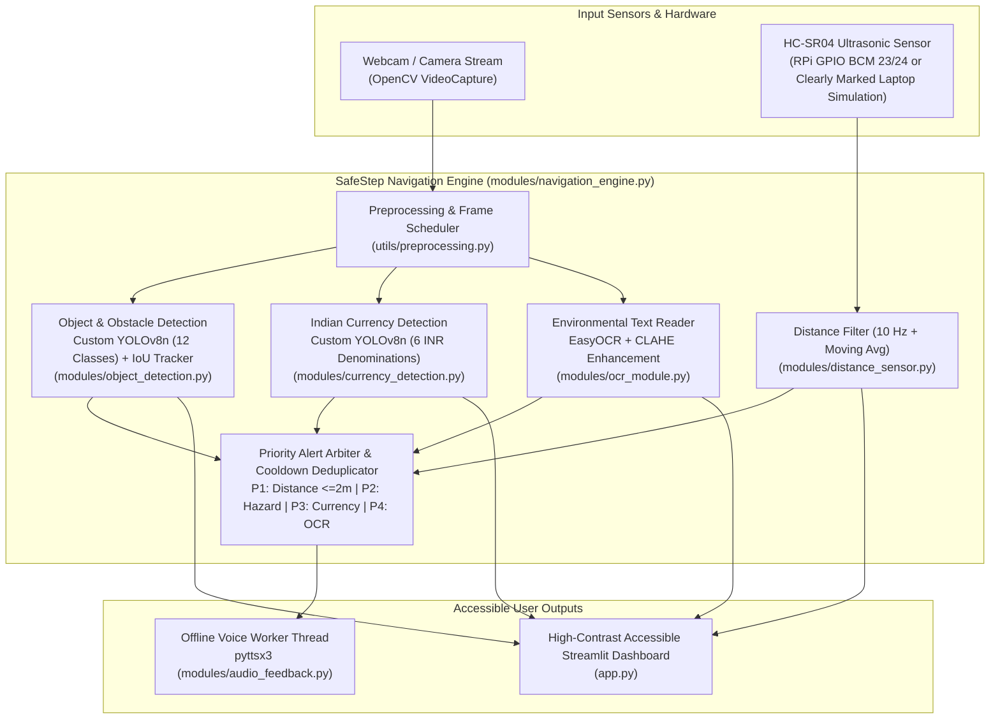
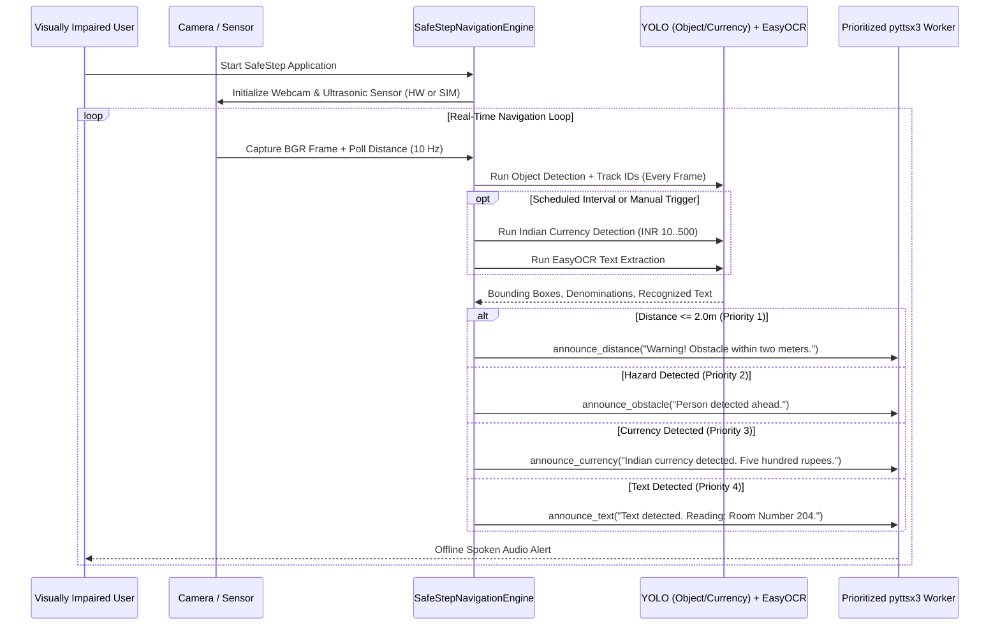

# SAFESTEP: AI-Enabled Smart Navigation System for the Visually Impaired with Integrated OCR and Currency Detection

> **⚠️ IMPORTANT SAFETY & AUTHENTICITY NOTICE**
> - **Assistive Prototype Disclaimer**: SafeStep is a research-oriented assistive navigation prototype. It is **not** a certified medical device and **not** a replacement for a white cane, guide dog, or professional orientation and mobility (O&M) training. Do not rely solely on SafeStep predictions when navigating roads, stairs, traffic, or hazardous environments.
> - **Currency Recognition Disclaimer**: The Indian currency detection module classifies only the **apparent visual denomination** (`₹10`, `₹20`, `₹50`, `₹100`, `₹200`, `₹500`) of banknotes and does **not** verify whether a banknote is genuine or authentic.

---

## 1. Project Overview

**SafeStep** is an offline-capable, multi-modal computer vision and audio-feedback navigation system designed to assist visually impaired users in understanding their surroundings through a camera, optional ultrasonic distance hardware, and prioritized voice alerts.

### Core Capabilities
1. **Real-Time Obstacle & Object Detection (Custom YOLOv8n + Optional MobileNetV3-SSD)**:
   - Detects 12 indoor/outdoor classes: `Person`, `Car`, `Motorcycle`, `Bicycle`, `Bus`, `Truck`, `Pole`, `Wall`, `Chair`, `Table`, `Door`, `Other obstacles`.
   - Includes cross-frame IoU + centroid tracking to suppress duplicate announcements and directional localization (`left`, `ahead`, `right`).
2. **Optical Character Recognition (EasyOCR)**:
   - Extracts environmental text from signboards, room numbers, notices, and labels with CLAHE contrast enhancement, confidence filtering, temporal deduplication, manual trigger, and configurable automatic interval mode.
3. **Indian Currency Denomination Recognition (Custom YOLOv8n)**:
   - Detects single or multiple Indian banknotes (`₹10`, `₹20`, `₹50`, `₹100`, `₹200`, `₹500`), calculates total value, returns structured JSON confidence scores, and announces denominations aloud.
4. **Ultrasonic Distance Measurement (HC-SR04 / Laptop Simulation)**:
   - Polls HC-SR04 hardware on Raspberry Pi GPIO at 10 Hz with moving-average filtering and triggers immediate Priority-1 stop warnings within 2.0 meters. Includes a clearly marked **SIMULATION** mode for standard Windows/Linux laptops.
5. **Prioritized Offline Audio Feedback (`pyttsx3`)**:
   - Background non-blocking speech worker with strict alert priority:
     1. Immediate ultrasonic obstacle distance warning (`<= 2.0m`)
     2. Hazard & obstacle detection
     3. Indian currency recognition
     4. Environmental OCR text reading

---

## 2. System Architecture Diagram



---

## 3. System Workflow Diagram



---

## 4. Project Directory Structure

```text
SafeStep/
├── app.py                              # 7-Section Accessible Streamlit Dashboard
├── config.yaml                         # Central system, model, sensor, and audio configuration
├── requirements.txt                    # Python package dependencies
├── README.md                           # Complete documentation & deployment guide
│
├── datasets/
│   ├── README.md                       # Dataset generation & expansion documentation
│   ├── object_detection/               # Dataset A (12 classes, YOLO format + metadata.csv)
│   ├── currency_detection/             # Dataset B (6 INR classes, YOLO format + metadata.csv)
│   └── dataset_generation/
│       ├── generate_object_dataset.py  # Programmatic + webcam-hybrid scene generator
│       ├── generate_currency_dataset.py# Indian currency specimen generator (Rs.10..Rs.500)
│       ├── collect_images.py           # Live webcam capture & local photo ingestion
│       ├── annotate_dataset.py         # YOLO bbox conversion & auto-annotation utility
│       ├── split_dataset.py            # Session-grouped 70/20/10 splitter (zero leakage)
│       ├── augment_dataset.py          # Albumentations bbox-aware augmentation
│       └── validate_dataset.py         # Integrity validator, class charts & sample mosaics
│
├── models/
│   ├── pretrained/                     # Base YOLOv8n weights
│   ├── object_detection/               # Trained custom object model (best.pt, best.onnx)
│   └── currency_detection/             # Trained custom currency model (best.pt, best.onnx)
│
├── training/
│   ├── train_object_detection.py       # Object detection transfer-learning pipeline
│   ├── train_currency_detection.py     # Currency detection transfer-learning pipeline
│   ├── evaluate_object_model.py        # Test-split evaluator & confusion matrix generator
│   ├── evaluate_currency_model.py      # Currency test-split evaluator & confusion matrix
│   ├── export_models.py                # ONNX / TFLite model exporter & ORT verifier
│   └── run_system_evaluation.py        # End-to-end system latency & condition benchmark
│
├── modules/
│   ├── object_detection.py             # YOLOv8 + MobileNet-SSD detector & IoU tracker
│   ├── ocr_module.py                   # EasyOCR text reader with deduplication
│   ├── currency_detection.py           # Multi-note INR denomination classifier
│   ├── distance_sensor.py              # HC-SR04 hardware & laptop simulation sensor
│   ├── audio_feedback.py               # Prioritized pyttsx3 offline voice queue
│   ├── camera.py                       # Thread-safe webcam & fallback stream manager
│   └── navigation_engine.py            # Multi-modal perception & alert coordinator
│
├── utils/
│   ├── preprocessing.py                # Frame validation, CLAHE OCR & currency enhancers
│   ├── visualization.py                # High-contrast accessible bounding-box & HUD renderer
│   ├── logger.py                       # YAML config loader & rotating file/console logger
│   └── performance.py                  # FPS, latency, CPU, and RAM telemetry monitor
│
├── evaluation/
│   ├── results/                        # JSON/CSV metrics for models and system benchmarks
│   ├── graphs/                         # Loss curves, confusion matrices, class distributions
│   └── reports/                        # Quality JSONs & experimental_evaluation_report.md
│
├── tests/
│   ├── test_object_detection.py
│   ├── test_currency_detection.py
│   ├── test_ocr.py
│   └── test_audio.py
│
└── hardware/
    ├── gpio_config.py                  # BCM GPIO pin constants for HC-SR04
    └── raspberry_pi_setup.py           # RPi hardware diagnostics & GPIO setup
```

---

## 5. Installation Instructions

```bash
# 1. Navigate to the SafeStep directory
cd SafeStep

# 2. (Optional) Create and activate a virtual environment
python -m venv .venv
# Windows PowerShell:
.venv\Scripts\Activate.ps1
# Linux / Raspberry Pi:
source .venv/bin/activate

# 3. Install dependencies
pip install -r requirements.txt
```

---

## 6. Dataset Generation, Splitting, Augmentation & Validation

Execute the modular dataset pipeline in sequence:

```bash
# 1. Generate base datasets (Dataset A: 750 base scenes, Dataset B: 850 base notes)
python datasets/dataset_generation/generate_object_dataset.py --count 750
python datasets/dataset_generation/generate_currency_dataset.py --count 850

# 2. Split by session_id into 70% train, 20% val, 10% test BEFORE augmentation (zero data leakage)
python datasets/dataset_generation/split_dataset.py --dataset both

# 3. Augment each split using Albumentations (produces >2,200 Object images and >2,500 Currency images)
python datasets/dataset_generation/augment_dataset.py --dataset both --multiplier 2

# 4. Validate bounding boxes, verify zero leakage, and generate distribution & sample plots
python datasets/dataset_generation/validate_dataset.py --dataset both
```

---

## 7. Training, Evaluating & Exporting the Models

```bash
# 1. Train Object Detection Model (Dataset A)
python training/train_object_detection.py --epochs 5 --batch 16 --imgsz 320

# 2. Train Indian Currency Detection Model (Dataset B)
python training/train_currency_detection.py --epochs 5 --batch 16 --imgsz 320

# 3. Evaluate both models on their held-out test splits
python training/evaluate_object_model.py --split test --imgsz 320
python training/evaluate_currency_model.py --split test --imgsz 320

# 4. Export trained models to ONNX and verify with ONNX Runtime
python training/export_models.py --imgsz 320

# 5. Run end-to-end system benchmark and generate experimental_evaluation_report.md
python training/run_system_evaluation.py
```

---

## 8. Running the Application & Automated Tests

```bash
# Run the complete unit and integration test suite
pytest tests/ -v

# Launch the SafeStep Streamlit User Interface
streamlit run app.py
```

---

## 9. Hardware Connection Guide & Raspberry Pi Deployment

### HC-SR04 Ultrasonic Sensor Wiring (BCM Pin Numbering)

| HC-SR04 Pin | Raspberry Pi 4B / 5 Pin | Notes |
| :--- | :--- | :--- |
| **VCC** | Physical Pin 2 (`5V`) | 5V power supply |
| **TRIG** | Physical Pin 16 (`GPIO 23`) | Output trigger pulse (10 µs) |
| **ECHO** | Physical Pin 18 (`GPIO 24`) | **Must** pass through a 1kΩ / 2kΩ voltage divider to step 5V down to 3.3V |
| **GND** | Physical Pin 6 (`GND`) | Common ground |

### Deploying on Raspberry Pi OS (64-bit Bookworm)

```bash
sudo apt update && sudo apt install -y python3-pip python3-venv espeak ffmpeg libatlas-base-dev
pip install RPi.GPIO gpiozero
python hardware/raspberry_pi_setup.py
streamlit run app.py --server.port 8501 --server.address 0.0.0.0
```
