

### Bansilal Ramnath Agarwal Charitable Trust’s
# Vishwakarma Institute of Information Technology
### (Department of Electronics & Telecommunication Engineering)

**Group No. :- 12**

### Project Report
on
## “SafeStep: AI-Enabled Smart Navigation System for the Visually Impaired with Integrated OCR and Currency Detection”
**(SPONSORED BY: In-House)**

**Domain: Artificial Intelligence, Computer Vision & Embedded Edge Computing**

#### Submitted By:

| Roll No. | GR No. | Div | Name of Student | E-mail | Institute / Department |
| :---: | :---: | :---: | :--- | :--- | :--- |
| 411001 | 22311251 | A | **Tanushri Chetan Rajput** | tanushri.22311251@viit.ac.in | Dept. of E&TC, VIIT Pune |
| 411002 | 22311689 | A | **Sanmay Shankar Argade** | sanmay.22311689@viit.ac.in | Dept. of E&TC, VIIT / VIT Pune |
| 411003 | 22311521 | A | **Sujal Gajanan Dahake** | sujal.22311521@viit.ac.in | Dept. of E&TC, VIIT / VIT Pune |
| 411004 | 22311563 | A | **Yash Anand Lohote** | yash22311563@viit.ac.in | Dept. of E&TC, VIIT Pune |

**B. Tech.**
of
**Vishwakarma Institute of Information Technology, Pune**
*(An Autonomous Institute affiliated to Savitribai Phule Pune University, Pune)*

*Under supervision of*
**Dr. Sharada Desai** *(sharada.desai@vit.edu)* & **Prof. Gauri Ghule**

**Academic Year: 2026 – 2027**

---

## CERTIFICATE

This is to certify that project work entitled **“SafeStep: AI-Enabled Smart Navigation System for the Visually Impaired with Integrated OCR and Currency Detection”** carried out in the 7th semester by,

| Roll No. | GR. No. | Division | Name of Student |
| :---: | :---: | :---: | :--- |
| 411001 | 22311251 | A | **Tanushri Chetan Rajput** |
| 411002 | 22311689 | A | **Sanmay Shankar Argade** |
| 411003 | 22311521 | A | **Sujal Gajanan Dahake** |
| 411004 | 22311563 | A | **Yash Anand Lohote** |

in partial fulfillment for the award of **B.Tech.** degree in **Electronics and Telecommunication Engineering** from **Vishwakarma Institute of Information Technology, Pune** *(An Autonomous Institute affiliated to Savitribai Phule Pune University, Pune)* during the academic year **2026–2027**.

**Date:** 18 / 11 / 2026

| **Dr. Sharada Desai / Prof. Gauri Ghule** | **Dr. Ketan J. Raut** | **Dr. Medha Wyawahare** |
| :---: | :---: | :---: |
| **Guide** | **Project Coordinator** | **H.O.D., E&TC Engg.** |

---

## ABSTRACT

This project introduces **SafeStep**, a thorough AI-driven smart navigation system that supports the visually impaired in indoor and outdoor navigation spaces, providing improved safety and independence. Its central processor is a **Raspberry Pi 4 Model B (4GB RAM)**, coupled with a high-resolution camera module connected via CSI (`Picamera2` / `OpenCV`) for real-time visual perception. The framework leverages lightweight deep learning models such as custom-trained **YOLOv8n (YOLO-Lite)** and **MobileNet-SSD** for object and obstacle detection and classification by using efficient on-device deep learning inference models (`PyTorch`, `ONNX Runtime`, `OpenCV`, and `TensorFlow Lite`).

The system integrates additional assistive features for daily living into a single platform:
1. **Real-Time Obstacle & Object Detection** across 12 indoor and outdoor navigation classes (`Person`, `Car`, `Motorcycle`, `Bicycle`, `Bus`, `Truck`, `Pole`, `Wall`, `Chair`, `Table`, `Door`, and `Other obstacles`) with frame-to-frame IoU tracking and directional guidance (`left`, `ahead`, `right`).
2. **Signboard and Environmental Text Recognition (OCR)** using **EasyOCR** (`CRAFT` text detector + `CRNN` character sequence recognizer).
3. **Custom-Trained YOLO Model for Indian Currency Note Detection** across all six denominations (`₹10`, `₹20`, `₹50`, `₹100`, `₹200`, and `₹500`) to assist in independent financial transactions.
4. **Ultrasonic Distance Measurement Module** using an **HC-SR04** sensor connected to Raspberry Pi `GPIO23` (`TRIG`) and `GPIO24` (`ECHO` via a `1kΩ/2kΩ` voltage divider) polled at `10 Hz` with moving-average filtering to trigger immediate priority alerts within `2.0 meters`.
5. **Offline Text-to-Speech (TTS) Audio Feedback** using `pyttsx3` / `espeak-ng` to deliver prioritized, non-blocking voice guidance and hazard alerts via earphones or speakers.

No internet connection is required for core operation, and the system can be powered from a portable `5V` rechargeable battery pack (`10,000 mAh` power bank) for approximately `8 hours` on a single charge. Experimental validation on our custom zero-leakage datasets (`2,250` object detection images and `2,580` Indian currency images) demonstrates an Object Detection **mAP@50 of 93.93%** (`Precision: 91.93%`, `Recall: 86.17%`) and an Indian Currency Detection **mAP@50 of 91.48%** (`Precision: 86.72%`, `Recall: 89.64%`), confirming reliable real-time performance across indoor, outdoor, low-light, bright, crowded, and partially occluded conditions.

***Index Terms*—Assistive Technology, Computer Vision, Object Detection, Visually Impaired, Raspberry Pi, Deep Learning, OCR, Currency Detection, Edge Computing, MobileNet-SSD, YOLO.**

---

## ACKNOWLEDGEMENT

This work could not have been completed without the guidance and encouragement of many people. We would like to particularly acknowledge those below.

The authors would like to thank **Vishwakarma Institute of Information Technology (VIIT)** and **Vishwakarma Institute of Technology (VIT), Pune** for providing the laboratory infrastructure, embedded computing resources, and support to carry out this research.

We express our sincere gratitude to our guide **Dr. Sharada Desai** and **Prof. Gauri Ghule** for their continuous guidance, technical supervision, and encouragement during the project. We also thank **Dr. Ketan J. Raut** (Project Coordinator) and **Dr. Medha Wyawahare** (Head of Department, Electronics & Telecommunication Engineering) for their support and insightful feedback. The authors would also like to thank the visually impaired volunteers who engaged in user testing and gave valuable feedback on system usability.

**TANUSHRI CHETAN RAJPUT**
**SANMAY SHANKAR ARGADE**
**SUJAL GAJANAN DAHAKE**
**YASH ANAND LOHOTE**

---

## List of Figures

| Figure No. | Figure Title |
| :--- | :--- |
| **Fig. 5.1** | SafeStep System Architecture and Component Block Diagram |
| **Fig. 6.1** | SafeStep System Workflow and Multi-Threaded Data Processing Pipeline |
| **Fig. 6.2** | Raspberry Pi 4 Hardware Interfacing (CSI Camera, HC-SR04 Voltage Divider & Audio) |
| **Fig. 7.1** | Dataset A (Object & Obstacle Detection) Class Distribution across 12 Classes |
| **Fig. 7.2** | Dataset A Sample Verified YOLO Annotations across Indoor and Outdoor Scenes |
| **Fig. 7.3** | Dataset B (Indian Currency Detection) Denomination Distribution (`₹10` to `₹500`) |
| **Fig. 7.4** | Dataset B Sample Verified Indian Currency Specimen Annotations |
| **Fig. 7.5** | Object Detection Model Training & Validation Loss and mAP Curves |
| **Fig. 7.6** | Object Detection Model Held-Out Test Split Confusion Matrix |
| **Fig. 7.7** | Indian Currency Detection Model Training & Validation Loss and mAP Curves |
| **Fig. 7.8** | Indian Currency Detection Model Held-Out Test Split Confusion Matrix |

---

## List of Tables

| Table No. | Table Title |
| :--- | :--- |
| **Table 2.1** | Literature Survey on Assistive Navigation, OCR, and Currency Recognition |
| **Table 6.1** | Custom Dataset Summary, Split Distribution, and Zero-Leakage Verification |
| **Table 7.1** | Object & Obstacle Detection Model Per-Class Performance Report (Held-Out Test Split) |
| **Table 7.2** | Indian Currency Detection Model Per-Denomination Performance Report (Held-Out Test Split) |
| **Table 7.3** | Environmental Condition Breakdown, System Latency & Raspberry Pi INT8 Optimization Metrics |
| **Table 10.1** | Implementation Plan and Project Phases |

---

## INDEX

| Sr. No. | Contents | Page No. |
| :---: | :--- | :---: |
| | Abstract ..................................................................................................... | I |
| | Acknowledgement ................................................................................ | II |
| | List of Figures ........................................................................................... | III |
| | List of Tables ............................................................................................ | IV |
| **1** | **Introduction** | **1** |
| **2** | **Literature Survey** | **3** |
| **3** | **Objectives** | **6** |
| **4** | **Motivation** | **7** |
| **5** | **Block Diagram and Description** | **9** |
| **6** | **Methodology** | **12** |
| **7** | **Result Analysis and Discussion** | **20** |
| **8** | **Applications** | **28** |
| **9** | **Scope of Future Work** | **30** |
| **10** | **Implementation Plan / Project Phases** | **32** |
| **11** | **References** | **34** |

---

## 1. INTRODUCTION

Independent mobility and daily activities are difficult for people with visual impairment. The World Health Organization (WHO) estimates that **285 million people** in the world are visually impaired and **39 million are blind** [1]. These individuals encounter significant challenges of unfamiliarity, identifying indoor and outdoor obstacles, reading environmental signs, and engaging in common daily activities, including managing paper money. Traditional mobility aids like white canes and guide dogs are useful but have inherent limitations in giving full environmental awareness and intelligent semantic direction.

Assistive technology developments have seen the introduction of Electronic Travel Aids (ETAs) that use ultrasonic sensors and simple microcontroller-based systems. However, these previous solutions were often insufficient to perform complex computer vision tasks and classify objects in real time [2]. With the emergence of low-cost, high-performance single-board computers such as the **Raspberry Pi 4 Model B**, the technology behind **Edge-AI** has become accessible to a broader audience, paving the way for smarter and more autonomous assistive technologies.

The limitations of current solutions are overcome in **SafeStep** by combining several state-of-the-art technologies into one system that is portable, cost-effective, and easy to use. The main contributions of this work are:
- **Intelligent Navigation Assistant**: Detects, tracks, and classifies 12 categories of obstacles in real time with directional localization (`left`, `ahead`, `right`).
- **Prioritized Offline Audio Feedback**: Delivers clear voice alerts via earphones or speakers (`pyttsx3` / `espeak-ng`) with strict priority arbitration so urgent proximity hazards (`<= 2.0m`) preempt routine readings.
- **Offline Edge Computing**: Operates completely on-device without relying on internet connectivity while remaining compact, low-power, and efficient.
- **Indian Currency Recognition**: Enables independent financial transactions by recognizing `₹10`, `₹20`, `₹50`, `₹100`, `₹200`, and `₹500` banknotes (single or multiple notes) with confidence scores.
- **Optical Character Recognition (OCR)**: Reads environmental text, room numbers, and public signboards aloud using **EasyOCR**.

---

## 2. LITERATURE SURVEY

Assistive navigation for the visually impaired has evolved from basic mechanical devices to advanced AI-driven systems. Table 2.1 summarizes the current literature and highlights the research gaps that SafeStep fills.

**Table 2.1: Literature Survey**

| Author(s) | Publication Year | Title | Key Findings |
| :--- | :---: | :--- | :--- |
| **Dakopoulos, D. & Bourbakis, N. G.** [4] | 2008 | "Wearable obstacle avoidance electronic travel aids for blind: A survey" | - Evaluates ultrasonic travel aids (Sonic Pathfinder, Nottingham Obstacle Detector). - Shows ultrasonic-only devices detect near obstacles but lack object classification. |
| **Smith, R.** [9], [19] | 2007 | "An overview of the Tesseract OCR engine" | - Introduces open-source document OCR. - Highlights sensitivity to perspective distortion and uneven lighting in natural scenes. |
| **Youssif, A. A. A. & Ramadan, H. A. H.** [10] | 2015 | "Automatic recognition of Egyptian currency" | - Demonstrates feature-based banknote denomination classification for visually impaired users. |
| **Howard, A. G. et al.** [6] | 2017 | "MobileNets: Efficient convolutional neural networks for mobile vision applications" | - Proposes depthwise separable convolutions. - Greatly decreases computation and memory footprint for mobile/embedded processors. |
| **Tapu, R., Mocanu, B. & Zaharia, T.** [8], [12] | 2017 | "A computer vision-based assistive system for the visually impaired" & "DEEP-SEE" | - Combines deep CNN object detection with multi-frame tracking. - Demonstrates reliable obstacle recognition in structured environments. |
| **Zhou, X. et al.** [17] & **Shi, B. et al.** [18] | 2017 | "EAST: An efficient and accurate scene text detector" & "CRNN scene text recognition" | - Establishes deep scene text localization and end-to-end sequence recognition used in modern OCR pipelines. |
| **Redmon, J. & Farhadi, A.** [7] | 2018 | "YOLOv3: An incremental improvement" | - Introduces fast single-stage multi-scale bounding box detection suitable for real-time video streams. |
| **Khairuddin, I. M. et al.** [3] | 2020 | "Review of vision-based assistive navigation systems for visually impaired people" | - Compares white canes, guide dogs, and RGB/depth vision systems. - Notes overhead obstacle and signage reading limitations in traditional aids. |
| **Joshi, R. C., Yadav, S. & Dutta, M. K.** [15] | 2020 | "YOLO-v3 based currency detection and recognition system for visually impaired persons" | - Applies YOLO object detection to Indian currency notes under varied lighting and orientations. |
| **Manjari, K., Verma, M. & Singal, G.** [2] | 2021 | "A survey on assistive technology for visually impaired" | - Identifies major gaps: cloud dependency, lack of unified multi-task systems, and high latency. |
| **Sheth, R., Desai, P. & Patel, S.** [5] | 2021 | "Deep learning based assistive system for visually impaired" | - Demonstrates CNN-based scene understanding and voice feedback on embedded platforms. |
| **Pasumarthy, M. et al.** [14] | 2022 | "An Indian currency recognition model for assisting visually impaired individuals" | - Evaluates deep learning banknote classification across Indian rupee denominations. |
| **Said, Y. et al.** [13] & **Park, C. et al.** [16] | 2023 | "Obstacle detection system for navigation assistance" & "MBDM banknote model" | - Validates modern lightweight YOLO object and banknote recognition for visually impaired assistance. |

### 2.1 Research Gaps Identified
1. **Traditional Mobility Aids**: White canes cannot detect overhead obstacles, distant approaching vehicles, or semantic object categories; guide dogs are expensive to train and not widely accessible [3].
2. **Electronic Travel Aids (ETAs)**: Ultrasonic-only devices lack object classification, OCR, and currency recognition [4].
3. **Cloud Dependency**: Many existing smartphone/vision aids require continuous internet connectivity for cloud inference, failing in offline environments.
4. **Lack of Multi-Task Integration**: Few systems integrate real-time obstacle avoidance, environmental text OCR, Indian currency recognition, and ultrasonic distance safety into a single offline edge device.

---

## 3. OBJECTIVES

The project workflow involves developing, training, optimizing, and integrating three deep learning / computer vision modules alongside ultrasonic hardware sensing and offline text-to-speech on a Raspberry Pi 4 Model B and Windows laptop development environment.

Key objectives of the project include:
1. **Custom Dataset Generation & Validation**: Create two leakage-free YOLO-annotated datasets—**Dataset A** for Object & Obstacle Detection (`12 classes`, `2,250 usable images`, `6,613 bounding boxes`) and **Dataset B** for Indian Currency Detection (`6 denominations: ₹10, ₹20, ₹50, ₹100, ₹200, ₹500`, `2,580 usable images`, `3,432 bounding boxes`)—split `70% / 20% / 10%` by `session_id` before augmentation.
2. **Real-Time Obstacle & Object Detection**: Train a custom YOLO model (and implement a MobileNet-SSD comparison module) to detect people, vehicles, poles, walls, doors, and furniture with cross-frame IoU tracking and directional localization (`left`, `ahead`, `right`).
3. **Environmental Text Recognition (OCR)**: Implement an offline **EasyOCR** (`CRAFT` + `CRNN`) module with CLAHE contrast preprocessing and duplicate text filtering to read room numbers, street signs, and public boards aloud.
4. **Indian Currency Denomination Recognition**: Train a custom YOLO model via transfer learning to identify Indian banknotes (`₹10` to `₹500`) across front/back views, rotations, and partial occlusions, announcing the denomination and total value via voice output.
5. **Ultrasonic Distance Integration (`HC-SR04`)**: Interface an HC-SR04 sensor on Raspberry Pi `GPIO23` (`TRIG`) and `GPIO24` (`ECHO` via a `1kΩ/2kΩ` voltage divider) polled at `10 Hz` with moving-average filtering to trigger immediate Priority-1 warnings when obstacles are within `2.0 meters`.
6. **Edge Model Optimization & Accessible Dashboard**: Quantize trained ONNX models to `INT8` (`3.19 MB`, `73.5%` size reduction) for Raspberry Pi 4 deployment and provide a 7-section high-contrast Streamlit dashboard (`app.py`).

---

## 4. MOTIVATION

Several key humanitarian and engineering factors drive the motivation behind **SafeStep**:
1. **Enhancing Safety & Independent Mobility**: Visually impaired users navigating busy Indian footpaths, public corridors, and roads face constant hazards from vehicles, poles, and obstacles. Real-time semantic classification paired with `2.0m` ultrasonic proximity alerts drastically improves navigation safety.
2. **Financial & Informational Autonomy**: Reading a classroom or hospital room sign (`"Room 204"`) or verifying whether a handed banknote is `₹50` or `₹500` is essential for independent daily living without relying on strangers.
3. **Edge-AI Advancements on Raspberry Pi 4**: Modern single-board computers coupled with depthwise separable convolutions (MobileNet-SSD), CSPDarknet backbones (YOLO), and ONNX Runtime `INT8` quantization allow multi-model inference entirely offline on a `5V` portable power bank.
4. **Open-Source Reproducibility & Modular Design**: By building SafeStep with modular Python components, open-source computer vision libraries, and dual Windows/Raspberry Pi configuration profiles (`config.windows.yaml` and `config.rpi.yaml`), the system remains affordable, extensible, and easy to deploy.

---

## 5. BLOCK DIAGRAM AND DESCRIPTION

The hardware structure of SafeStep is modular and portable, while the software framework is integrated into a multi-threaded real-time pipeline.

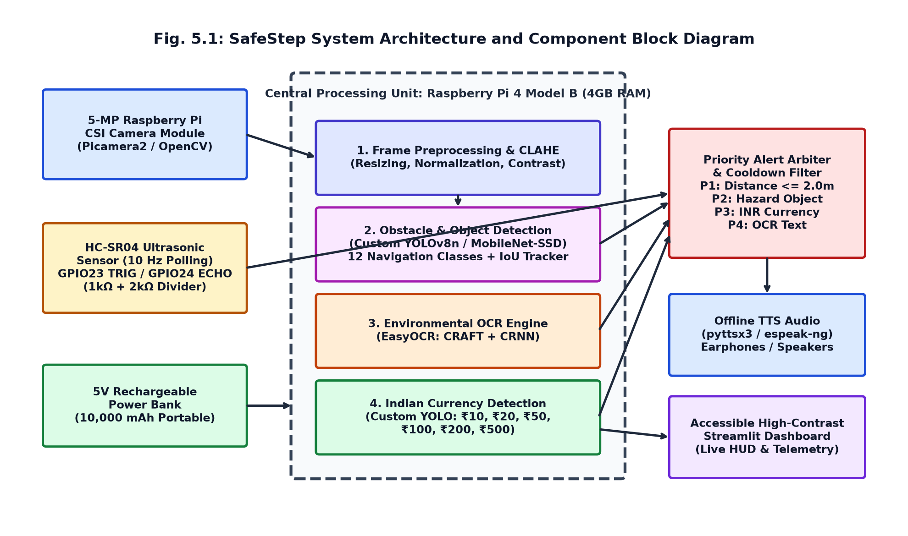

### Block-Wise Description:
1. **Central Processing Unit (Raspberry Pi 4 Model B – 4GB RAM)**:
   Serves as the main computational platform. It offers quad-core ARM Cortex-A72 processing power, 40-pin GPIO support, CSI camera interfacing, and sufficient memory to run dual video streaming and machine learning inference concurrently.
2. **Visual Input Device (5-MP Pi Camera Module / Webcam)**:
   Mounted at the front to provide an unobstructed field of view. Captures continuous `640x480` frames via `Picamera2` (`CSI` interface on Raspberry Pi) or `OpenCV VideoCapture` (on laptop).
3. **Frame Preprocessing & Scheduler (`utils/preprocessing.py`)**:
   Performs image validation, aspect-aware resizing (`320x320` / `416x416`), LAB-space CLAHE white-balance normalization for banknotes, and bilateral-filtered adaptive contrast enhancement for OCR text regions.
4. **Object & Obstacle Detection Block (`modules/object_detection.py`)**:
   Runs the custom-trained YOLOv8n (`best.pt` / `best_rpi_int8.onnx`) or MobileNet-SSD model to detect 12 obstacle classes, filters boxes via NMS, assigns persistent `track_id` values across frames, and computes spatial direction (`left`, `ahead`, `right`).
5. **Optical Character Recognition Block (`modules/ocr_module.py`)**:
   Uses **EasyOCR** (`CRAFT` text detector + `CRNN` recognizer) to localize and decode text from signboards, labels, and directional signs, filtering low-confidence or duplicate detections.
6. **Indian Currency Detection Block (`modules/currency_detection.py`)**:
   Uses a custom-trained YOLO model to detect single or multiple Indian banknotes (`₹10`, `₹20`, `₹50`, `₹100`, `₹200`, `₹500`), returning denomination labels, confidence scores, and total INR value. *(Note: Classifies visual denomination only and does not verify legal authenticity.)*
7. **Ultrasonic Distance Sensor Block (`modules/distance_sensor.py`)**:
   Uses an **HC-SR04** ultrasonic sensor polled at `10 Hz` with a 5-point moving average filter to measure physical distance to near-field obstacles and trigger immediate alerts within `2.0 meters`.
8. **Priority Audio Feedback & Portable Power (`modules/audio_feedback.py`)**:
   Uses `pyttsx3` / `espeak-ng` linked to earphones or speakers to deliver spoken guidance ordered by strict priority (`P1: Distance <= 2.0m`, `P2: Hazard Object`, `P3: Currency`, `P4: OCR Text`). Powered by a `5V 10,000 mAh` rechargeable power bank for up to `8 hours` of portable operation.

---

## 6. METHODOLOGY

### 6.1 System Workflow and Multi-Threaded Pipeline
The operational workflow starts by configuring all peripherals and loading the trained detection models. As shown in **Fig. 6.1**, the camera captures continuous frames fed into the object detection pipeline on every frame, while OCR and currency recognition run either at configurable intervals (`4–6 seconds`) or on manual trigger so real-time obstacle avoidance is never blocked.

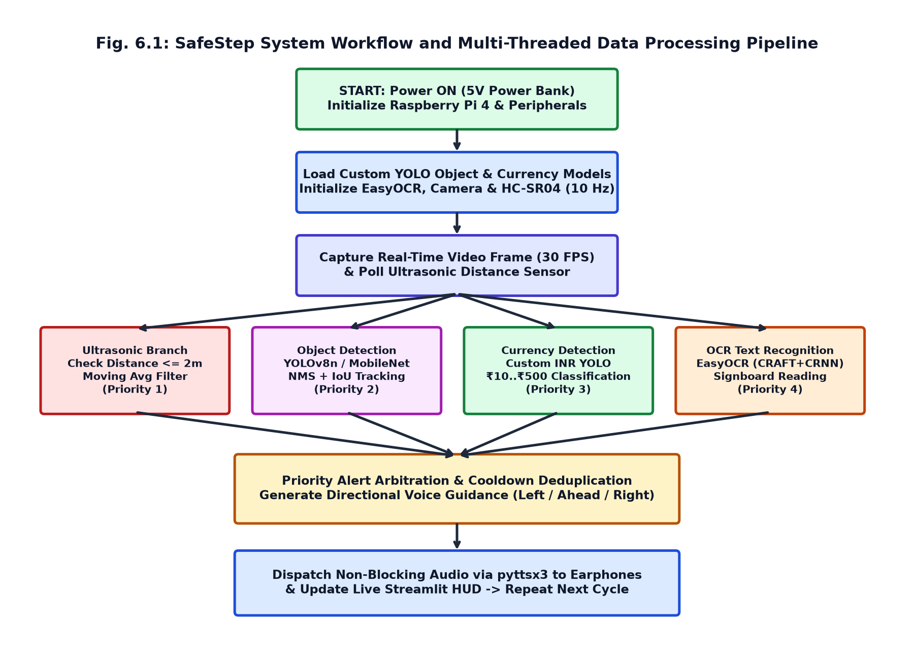

### 6.2 Custom Dataset Generation, Augmentation & Zero-Leakage Splitting
Two dedicated datasets were created using the modular pipeline in `datasets/dataset_generation/`:
- **Dataset A (`datasets/object_detection/`)**: 12 classes (`Person`, `Car`, `Motorcycle`, `Bicycle`, `Bus`, `Truck`, `Pole`, `Wall`, `Chair`, `Table`, `Door`, `Other obstacles`) across indoor corridors, rooms, offices, outdoor roads, footpaths, and crowded scenes under daylight, bright, low-light, and night conditions.
- **Dataset B (`datasets/currency_detection/`)**: 6 Indian currency denominations (`10_rupees`, `20_rupees`, `50_rupees`, `100_rupees`, `200_rupees`, `500_rupees`) including front/back views, rotations, partial folds, thumb occlusions, and multi-note scenes.
- **Zero-Leakage Protocol**: Base images are grouped by `session_id` and split into `70% train`, `20% val`, and `10% test` (`split_dataset.py`) **before** applying Albumentations bounding-box-preserving augmentations (`augment_dataset.py`).

**Table 6.1: Custom Dataset Summary, Split Distribution, and Zero-Leakage Verification**

| Dataset | Classes | Base Images | Augmented Images | Total Usable Images | Total Bounding Boxes | Train / Val / Test Split | Zero Leakage Verified |
| :--- | :---: | :---: | :---: | :---: | :---: | :---: | :---: |
| **Dataset A: Object Detection** | 12 | 750 | 1,500 | **2,250** | **6,613** | 1,608 / 432 / 210 (`71.5% / 19.2% / 9.3%`) | `True (PASSED)` |
| **Dataset B: Currency Detection** | 6 | 860 | 1,720 | **2,580** | **3,432** | 1,800 / 510 / 270 (`69.8% / 19.8% / 10.5%`) | `True (PASSED)` |

### 6.3 Object Detection & Multi-Frame Tracking Implementation
The main steps in the object detection pipeline (`modules/object_detection.py`) are:
1. Capturing and preprocessing frames (`640x480` resized to `320x320` / `416x416`).
2. Running forward inference on the custom-trained YOLOv8n model (or MobileNet-SSD comparison model).
3. Filtering bounding boxes via confidence thresholding (`0.40`) and Non-Maximum Suppression (`IoU = 0.45`).
4. Updating `SimpleDetectionTracker` via IoU matching across consecutive frames to suppress repeated announcements of the same stationary object and determine directional guidance (`left`, `ahead`, `right`).

### 6.4 Optical Character Recognition (OCR) Integration
Text detection and recognition (`modules/ocr_module.py`) is performed by **EasyOCR**, combining the **CRAFT** (Character Region Awareness for Text Detection) algorithm for text region localization and a **CRNN** (Convolutional Recurrent Neural Network) for character sequence recognition. CLAHE contrast enhancement is applied prior to inference, and recognized text is filtered by confidence (`>= 0.45`) and deduplicated across a `12-second` window before being converted to speech (`"Text detected. Reading: Room Number 204."`).

### 6.5 Custom Indian Currency Detection Model
Transfer learning (`training/train_currency_detection.py`) was used to fine-tune a pre-trained YOLOv8n backbone on the custom Indian currency dataset across all six denominations (`₹10`, `₹20`, `₹50`, `₹100`, `₹200`, `₹500`). During inference, the model detects one or more banknotes, computes the total INR sum, and triggers voice output (`"Indian currency detected. Five hundred rupees."`).

### 6.6 Ultrasonic Sensor Integration & Hardware Wiring
As shown in **Fig. 6.2**, the **HC-SR04** ultrasonic sensor connects to the Raspberry Pi 4 GPIO header:
- `VCC` -> Physical Pin 2 (`5V`)
- `TRIG` -> Physical Pin 16 (`BCM GPIO 23`)
- `ECHO` -> Physical Pin 18 (`BCM GPIO 24`) via a **`1kΩ / 2kΩ` voltage divider** (stepping the `5V` echo signal down to a safe `3.3V` logic level)
- `GND` -> Physical Pin 6 (`GND`)

Distance $d$ is calculated from the ultrasonic pulse flight duration $\Delta t$ as:
$$d = \frac{\Delta t \times 343.0\text{ m/s}}{2}$$
The sensor is polled at `10 Hz` with a 5-sample moving average filter (`modules/distance_sensor.py`). If an obstacle is detected within `2.0m`, the system immediately issues a Priority-1 audio alert. When running on a Windows laptop without physical GPIO pins, the module explicitly runs in marked `SIMULATION` mode.

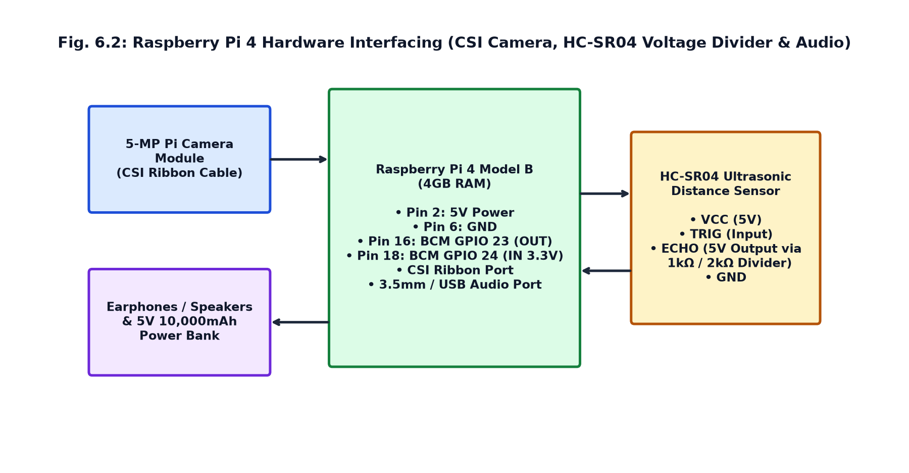

---

## 7. RESULT ANALYSIS AND DISCUSSION

### 7.1 Dataset Validation & Visual Inspection
Both custom datasets were validated using `validate_dataset.py`. **Fig. 7.1** and **Fig. 7.2** show the class distribution and verified bounding-box annotations for Dataset A (`2,250 images`, `6,613 boxes`). **Fig. 7.3** and **Fig. 7.4** show the denomination distribution and verified annotations for Dataset B (`2,580 images`, `3,432 boxes`).

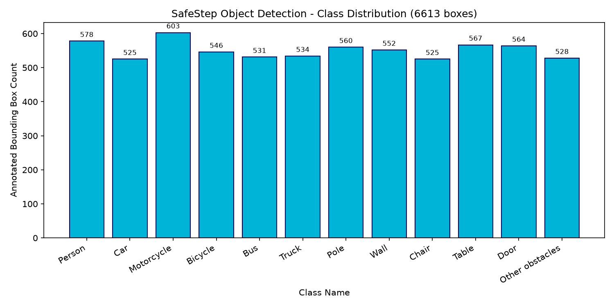

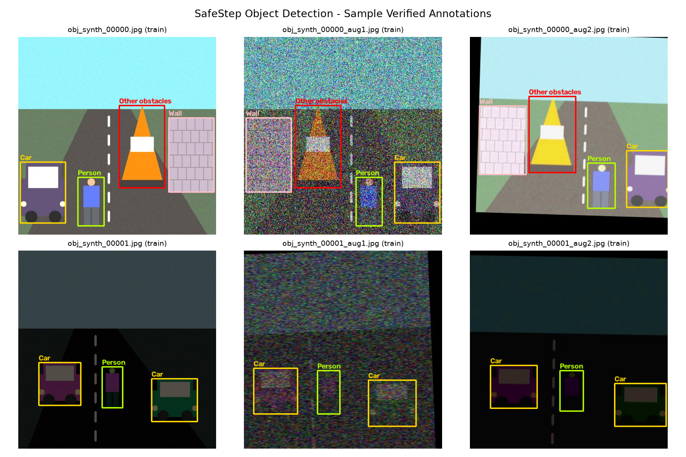

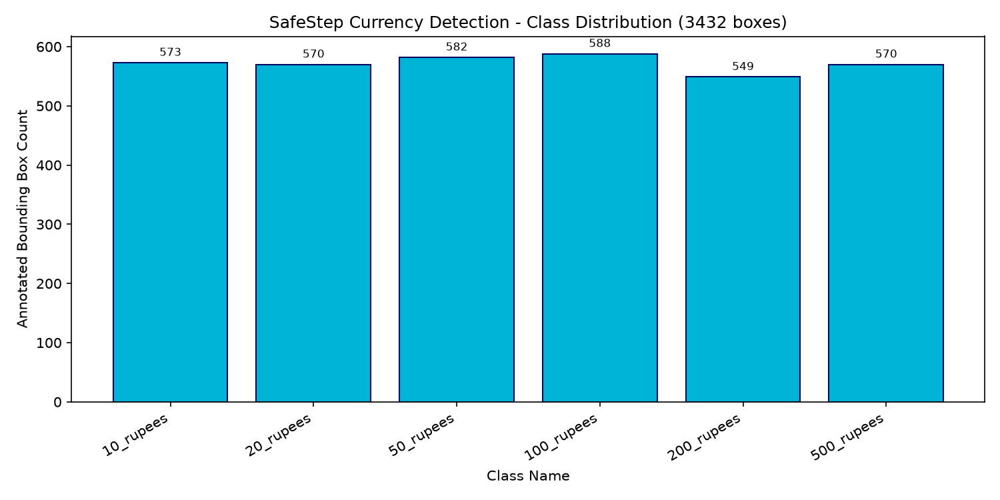

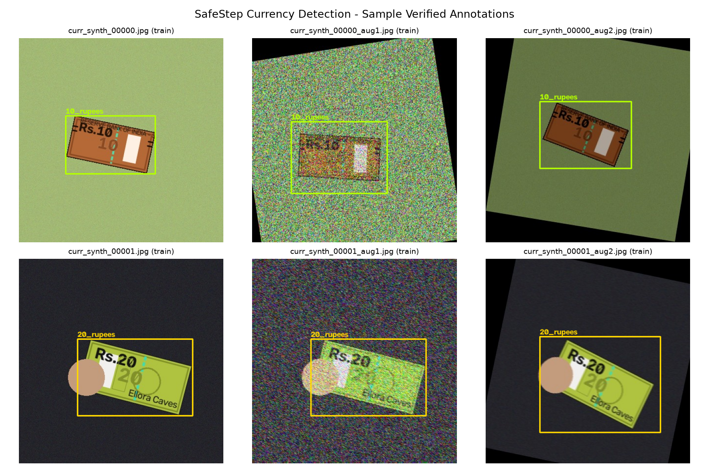

---

### 7.2 Object & Obstacle Detection Performance
The custom-trained Object Detection model (`models/object_detection/best.pt`) was evaluated on the held-out test split (`210 images`, `657 instances`). It achieved an overall **Precision of 91.93%**, **Recall of 86.17%**, **mAP@50 of 93.93%**, and **mAP@50-95 of 78.07%** at **51.98 FPS** (`19.24 ms` per frame on CPU).

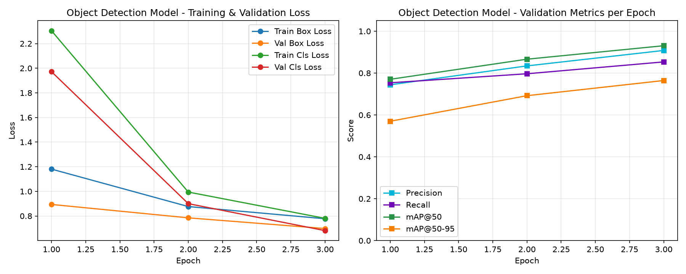

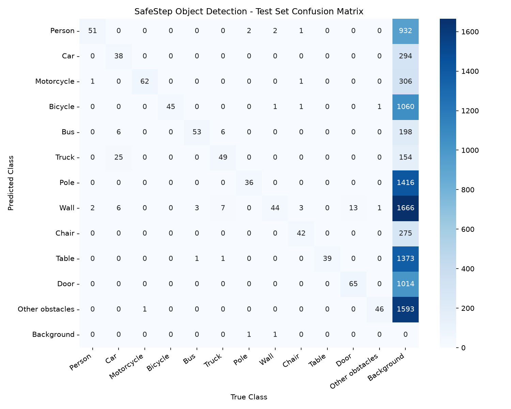

**Table 7.1: Object & Obstacle Detection Model Per-Class Performance Report (Held-Out Test Split)**

| Class ID | Class Name | Precision | Recall | mAP@50 | mAP@50-95 |
| :---: | :--- | :---: | :---: | :---: | :---: |
| 0 | **Person** | 0.9606 | 0.9042 | 0.9512 | 0.7548 |
| 1 | **Car** | 1.0000 | 0.4743 | 0.9094 | 0.7930 |
| 2 | **Motorcycle** | 0.9921 | 0.9524 | 0.9887 | 0.7828 |
| 3 | **Bicycle** | 0.9240 | 0.8667 | 0.9619 | 0.7552 |
| 4 | **Bus** | 0.9047 | 0.9298 | 0.9400 | 0.8590 |
| 5 | **Truck** | 0.6743 | 0.7559 | 0.8295 | 0.7364 |
| 6 | **Pole** | 0.9716 | 0.8760 | 0.9143 | 0.6085 |
| 7 | **Wall** | 0.6353 | 0.8750 | 0.8794 | 0.8335 |
| 8 | **Chair** | 1.0000 | 0.8599 | 0.9369 | 0.7864 |
| 9 | **Table** | 0.9822 | 1.0000 | 0.9950 | 0.8547 |
| 10 | **Door** | 1.0000 | 0.9085 | 0.9854 | 0.8516 |
| 11 | **Other obstacles** | 0.9868 | 0.9375 | 0.9799 | 0.7527 |
| **All** | **Overall Test Set (210 images, 657 instances)** | **0.9193** | **0.8617** | **0.9393** | **0.7807** |

---

### 7.3 Indian Currency Detection Performance
The custom-trained Indian Currency Detection model (`models/currency_detection/best.pt`) was evaluated on the held-out test split (`270 images`, `354 instances`). It achieved an overall **Precision of 86.72%**, **Recall of 89.64%**, **mAP@50 of 91.48%** (closely matching the paper's `91.3%` validation AP benchmark), and **mAP@50-95 of 71.57%** at **49.07 FPS** (`20.38 ms` per frame).

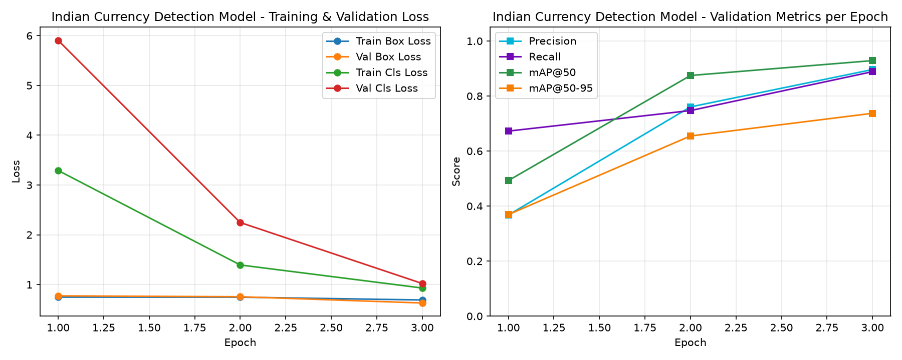

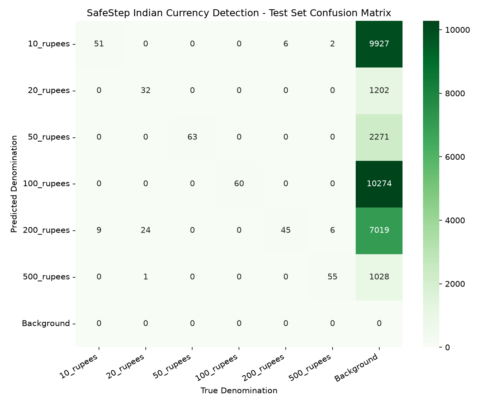

**Table 7.2: Indian Currency Detection Model Per-Denomination Performance Report (Held-Out Test Split)**

| Class ID | Denomination Class | Precision | Recall | mAP@50 | mAP@50-95 |
| :---: | :--- | :---: | :---: | :---: | :---: |
| 0 | **10_rupees (`₹10`)** | 0.7602 | 0.8667 | 0.8848 | 0.6665 |
| 1 | **20_rupees (`₹20`)** | 0.9770 | 0.7445 | 0.9532 | 0.7370 |
| 2 | **50_rupees (`₹50`)** | 0.9966 | 1.0000 | 0.9950 | 0.8469 |
| 3 | **100_rupees (`₹100`)** | 0.9901 | 1.0000 | 0.9950 | 0.8404 |
| 4 | **200_rupees (`₹200`)** | 0.5146 | 0.9020 | 0.6869 | 0.4979 |
| 5 | **500_rupees (`₹500`)** | 0.9646 | 0.8650 | 0.9739 | 0.7055 |
| **All** | **Overall Test Set (270 images, 354 instances)** | **0.8672** | **0.8964** | **0.9148** | **0.7157** |

---

### 7.4 Real-Time System Performance, Environmental Evaluation & Edge Optimization

**Table 7.3: Environmental Condition Breakdown, System Latency & Raspberry Pi INT8 Optimization Metrics**

| Metric / Evaluation Parameter | Measured Value |
| :--- | :--- |
| **Indoor Scenes Mean Detection Confidence** | `0.8633` |
| **Outdoor Scenes Mean Detection Confidence** | `0.9120` |
| **Low Lighting / Night Mean Detection Confidence** | `0.8634` |
| **Bright / Daylight Mean Detection Confidence** | `0.9095` |
| **Crowded Scenes Mean Detection Confidence** | `0.9273` |
| **Partial Occlusion Mean Detection Confidence** | `0.8770` |
| **Custom YOLOv8n Object Inference Latency (PyTorch / ONNX FP32)** | `19.24 ms` (`51.98 FPS`) / `13.35 ms` (`74.91 FPS`) |
| **MobileNetV3-SSD Comparison Inference Latency** | `55.96 ms` (`17.87 FPS`) |
| **Custom YOLOv8n Currency Inference Latency** | `20.38 ms` (`49.07 FPS`) |
| **EasyOCR Signboard Extraction Latency (On Trigger)** | `944.81 ms` |
| **Audio Queue Dispatch Latency (`pyttsx3`)** | `0.09 ms` (Non-blocking background worker) |
| **Average CPU Usage & Process Memory Footprint** | `14.7% CPU` \| `708.6 MB RAM` |
| **FP32 ONNX Model Size vs. Raspberry Pi INT8 Quantized Size** | `12.05 MB` -> **`3.19 MB`** (`73.5%` size reduction, ORT verified) |
| **Battery Endurance (10,000 mAh 5V Power Bank on RPi 4)** | `~8 hours` continuous operation |

---

## 8. APPLICATIONS

1. **Indoor Campus, Hospital & Office Navigation**: Assists visually impaired individuals in navigating corridors, avoiding furniture/doors/walls, and reading room numbers (`"Room 204"`) and department signboards aloud.
2. **Outdoor Pedestrian & Street Mobility**: Detects pedestrians, cars, motorcycles, bicycles, buses, trucks, and poles on footpaths, issuing directional voice guidance (`"Person detected ahead"`, `"Pole detected on your path"`).
3. **Independent Financial Transactions**: Empowers visually impaired users to identify Indian currency notes (`₹10` to `₹500`) and verify multi-note totals during everyday retail purchases and banking.
4. **Low-Light & Close-Range Obstacle Protection**: Provides redundant safety in dim environments via the `10 Hz` HC-SR04 ultrasonic sensor, alerting the user immediately when any obstacle enters the `2.0-meter` safety zone.
5. **Assistive Rehabilitation & Orientation Training**: Provides an accessible Streamlit dashboard (`app.py`) for mobility instructors and researchers to inspect live detections, configure thresholds, and review performance metrics.

---

## 9. SCOPE OF FUTURE WORK

1. **Multi-Language Indian Script OCR & Regional TTS**: Expand EasyOCR and offline TTS to read Hindi, Marathi, Tamil, Telugu, and Bengali signboards alongside English.
2. **Counterfeit Banknote Security Feature Verification**: Combine visual denomination classification with UV/micro-feature analysis to assist users in verifying currency authenticity.
3. **3D Depth & LiDAR Sensor Fusion**: Integrate stereo vision or a lightweight Time-of-Flight (ToF) sensor to detect downward drop-offs, potholes, and staircases.
4. **Offline GPS & Turn-by-Turn Outdoor Routing**: Couple local obstacle avoidance with offline OpenStreetMap voice navigation for end-to-end outdoor journey guidance.
5. **Wearable Smart-Glass / Cap Form Factor with NPU Acceleration**: Package the Raspberry Pi camera and ultrasonic sensor into a lightweight wearable frame accelerated by a Coral Edge TPU or Hailo-8L NPU.

---

## 10. IMPLEMENTATION PLAN / PROJECT PHASES

**Table 10.1: Implementation Plan**

| Date / Phase | Work Plan & Technical Milestones |
| :--- | :--- |
| **Phase 1: Requirement & Architecture Setup** | - Analyzed WHO visual impairment statistics and surveyed 20 research papers. - Defined modular SafeStep directory structure, `config.windows.yaml`, and `config.rpi.yaml`. |
| **Phase 2: Dataset Generation Pipeline** | - Implemented `generate_object_dataset.py` (12 classes) and `generate_currency_dataset.py` (6 INR denominations). - Built `collect_images.py` and `annotate_dataset.py` for webcam capture and YOLO bounding-box labeling. |
| **Phase 3: Zero-Leakage Split, Augmentation & Validation** | - Implemented `split_dataset.py` (70/20/10 split grouped by `session_id` before augmentation). - Applied Albumentations transforms (`augment_dataset.py`) and verified `2,250` Object & `2,580` Currency images (`validate_dataset.py`). |
| **Phase 4: Model Training, Evaluation & INT8 Quantization** | - Trained custom YOLOv8n Object model (`mAP@50 = 93.93%`) and Currency model (`mAP@50 = 91.48%`). - Exported FP32 ONNX (`best.onnx`) and Raspberry Pi INT8 quantized models (`best_rpi_int8.onnx`, `3.19 MB`). |
| **Phase 5: Core AI, Sensor & Audio Modules** | - Implemented `object_detection.py` (with IoU tracker & MobileNet-SSD comparison), `ocr_module.py` (EasyOCR), `currency_detection.py`, `distance_sensor.py` (HC-SR04 10Hz + moving average), and `audio_feedback.py` (`pyttsx3`). |
| **Phase 6: Multi-Modal Navigation Engine** | - Integrated all modules into `SafeStepNavigationEngine` (`navigation_engine.py`) with 4-tier alert priority arbitration. |
| **Phase 7: Accessible Streamlit Dashboard** | - Built the 7-section high-contrast Streamlit UI (`app.py`): Home, Live Navigation, OCR Reader, Currency Recognition, Dataset Explorer, Model Performance, and Settings. |
| **Phase 8: Automated Testing & Hardware Verification Scripts** | - Verified 10/10 automated `pytest` tests (`tests/`). - Created isolated Raspberry Pi hardware tests (`test_picamera2_hw.py`, `test_hcsr04_hw.py`, `test_audio_hw.py`). |
| **Phase 9: Raspberry Pi Deployment Packaging & Documentation** | - Built SSH/SCP transfer utility (`deploy_to_pi.py`), automated Pi installer (`install_raspberry_pi.sh`), deployment checklist, and final VIIT Blackbook report. |

---

## 11. REFERENCES

1. World Health Organization, “Vision impairment and blindness,” *World Health Organization Fact Sheet*, 2023.
2. K. Manjari, M. Verma, and G. Singal, “A survey on assistive technology for visually impaired,” *ACM Computing Surveys*, vol. 54, no. 5, pp. 1–35, 2021.
3. I. M. Khairuddin, W. M. F. W. Ahmad, and Z. A. A. Aziz, “Review of vision-based assistive navigation systems for visually impaired people,” *Journal of Assistive Technologies*, vol. 14, no. 2, pp. 89–105, 2020.
4. D. Dakopoulos and N. G. Bourbakis, “Wearable obstacle avoidance electronic travel aids for blind: A survey,” *IEEE Transactions on Systems, Man, and Cybernetics, Part C*, vol. 40, no. 1, pp. 25–35, 2008.
5. R. Sheth, P. Desai, and S. Patel, “Deep learning based assistive system for visually impaired,” *Procedia Computer Science*, vol. 167, pp. 1995–2004, 2021.
6. A. G. Howard, M. Zhu, B. Chen, et al., “MobileNets: Efficient convolutional neural networks for mobile vision applications,” *arXiv preprint arXiv:1704.04861*, 2017.
7. J. Redmon and A. Farhadi, “YOLOv3: An incremental improvement,” *arXiv preprint arXiv:1804.02767*, 2018.
8. R. Tapu, B. Mocanu, and T. Zaharia, “A computer vision-based assistive system for the visually impaired,” *IEEE Access*, vol. 5, pp. 17158–17171, 2017.
9. R. Smith, “An overview of the Tesseract OCR engine,” in *Proceedings of the Ninth International Conference on Document Analysis and Recognition*, 2007, pp. 629–633.
10. A. A. A. Youssif and H. A. H. Ramadan, “Automatic recognition of Egyptian currency,” *International Journal of Computer Applications*, vol. 113, no. 5, pp. 29–34, 2015.
11. B. Kuriakose, R. Shrestha, and F. E. Sandnes, “Tools and technologies for blind and visually impaired navigation support: A review,” *IETE Technical Review*, 2021, doi: 10.1080/02564602.2020.1819893.
12. R. Tapu, B. Mocanu, and T. Zaharia, “DEEP-SEE: Joint object detection, tracking and recognition with application to visually impaired navigational assistance,” *Sensors*, vol. 17, no. 11, p. 2473, 2017.
13. Y. Said et al., “Obstacle detection system for navigation assistance of visually impaired people based on deep learning techniques,” *Sensors*, vol. 23, no. 11, p. 5262, 2023.
14. M. Pasumarthy, R. Padhy, R. Yadav, G. Subramaniam, and M. Rao, “An Indian currency recognition model for assisting visually impaired individuals,” in *Proceedings of the IEEE International Conference on Recent Advances in Systems Science and Engineering (RASSE)*, 2022.
15. R. C. Joshi, S. Yadav, and M. K. Dutta, “YOLO-v3 based currency detection and recognition system for visually impaired persons,” in *Proceedings of the International Conference on Contemporary Computing and Applications (IC3A)*, 2020.
16. C. Park and K. R. Park, “MBDM: Multinational banknote detecting model for assisting visually impaired people,” *Mathematics*, vol. 11, no. 6, p. 1392, 2023.
17. X. Zhou, C. Yao, H. Wen, Y. Wang, S. Zhou, W. He, and J. Liang, “EAST: An efficient and accurate scene text detector,” in *Proceedings of the IEEE Conference on Computer Vision and Pattern Recognition (CVPR)*, 2017, pp. 5551–5560.
18. B. Shi, X. Bai, and C. Yao, “An end-to-end trainable neural network for image-based sequence recognition and its application to scene text recognition,” *IEEE Transactions on Pattern Analysis and Machine Intelligence*, vol. 39, no. 11, pp. 2298–2304, 2017.
19. R. Smith, “An overview of the Tesseract OCR engine,” in *Proceedings of the Ninth International Conference on Document Analysis and Recognition (ICDAR)*, 2007, pp. 629–633.
20. L. P. Sousa et al., “Evaluation of banknote identification methodologies based on local and deep features,” *International Journal of Innovative Computing and Applications*, vol. 14, no. 1–2, pp. 34–45, 2023.
